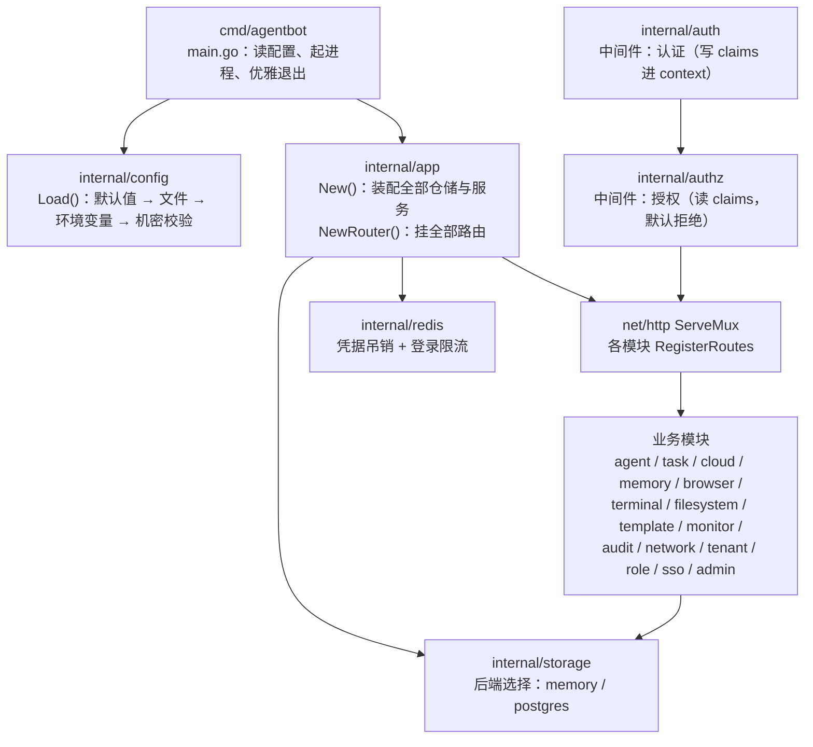
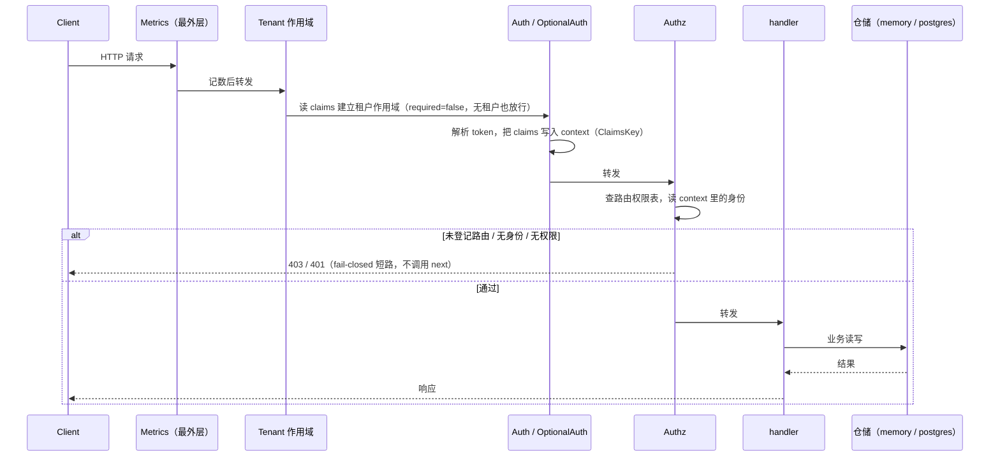
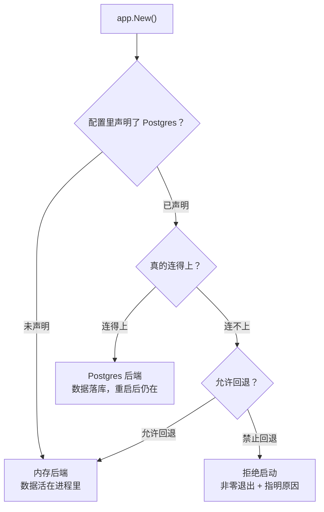

# AgentBot 文档索引

这里是 AgentBot 文档的**唯一入口**。下面按「我要做什么」组织，而不是按文件名罗列 ——
每篇都注明**什么时候该读**和**读完能回答什么问题**。

---

## 我要先把项目跑起来

| 顺序 | 文档 | 什么时候读 | 读完能回答 |
|------|------|-----------|-----------|
| 1 | [README](../README.md) | 第一次接触仓库 | 这是什么、能做什么、怎么起 |
| 2 | [deployment.md](deployment.md) | 准备部署 / 改配置 | 配置从哪来、哪些机密没有默认值、缺了会怎样 |
| 3 | [persistence.md](persistence.md) | 接数据库 | 数据落在内存还是 Postgres、怎么迁移、回退点在哪 |
| 4 | [redis.md](redis.md) | 配 Redis | Redis 用来做什么、不配会怎样 |

> **最短路径**：`AGENTBOT_AUTH_JWT_SECRET=... go run ./cmd/agentbot` 即可启动，
> 全部外部依赖都有降级路径。三个必需机密见 [deployment.md 的「为什么机密没有默认值」](deployment.md#1-为什么机密没有默认值)。

## 我要理解设计取舍

| 文档 | 什么时候读 | 读完能回答 |
|------|-----------|-----------|
| [persistence.md](persistence.md) | 质疑「为什么不直接全上 DB」 | 为什么分批迁移、为什么内存实现必须留着、两套实现如何共存 |
| [sandbox.md](sandbox.md) | 想知道隔离做到什么程度 | 进程级沙箱的边界在哪、哪里**不是**安全边界、与容器的差距 |
| [mcp.md](mcp.md) | 要接外部工具 server | 支持哪些 MCP 方法、四类错误怎么区分、server 进程由谁管 |
| [redis.md](redis.md) | 想知道为什么失败方向不一致 | 哪些组件 fail-open、哪些 fail-closed、为什么刻意相反 |
| [performance.md](performance.md) | 想改连接池 / 怀疑慢了 | 基线数字是多少、怎么复现、慢的时候先查什么 |

## 我要排障

| 症状 | 去读 |
|------|------|
| 启动直接退出、提示缺环境变量 | [deployment.md](deployment.md) |
| 接口 403，但 handler 里看着能过 | [observability.md](observability.md)（路由 + 授权链路） |
| 数据库看起来连上了，数据却查不到 | [persistence.md](persistence.md)（后端选择 ≠ 真的落库） |
| 数据库操作慢得不正常 | [performance.md 的「连接池从未生效」](performance.md#5--本轮用一个基准抓出的真-bug连接池从未生效)（先查连接池，别先怪磁盘） |
| 日志里找不到某次请求发生了什么 | [observability.md 的「请求追踪」](observability.md#3-请求追踪) |
| 想知道某个接口怎么调 | [api.md](api.md) |

## 我要改代码 / 加接口

| 文档 | 用途 |
|------|------|
| [api.md](api.md) | 全部 HTTP 接口清单 + 请求响应示例 |
| [observability.md](observability.md) | 指标、日志分级、请求追踪的接入点 |
| [sandbox.md](sandbox.md) | 要执行外部命令时该走哪条路径 |
| [performance.md](performance.md) | 改动关键路径后怎么证明没有回归 |

---

## 架构

### 分层与装配



**关键点**：`internal/config.Load` 是**唯一**的配置读取入口，业务模块一律不得
直接 `os.Getenv`；`internal/app` 是**唯一**的装配层，模块之间不互相 new。

### 一次已认证请求的链路

实际执行顺序（`internal/app/router.go` 末尾，由内向外包装，最后赋值的在最外层）：

```
Metrics → Recovery → RequestID → CORS → Logging → Tenant → Auth(OptionalAuth) → Authz → mux
```



**关键点**：

1. 中间件是**由内向外**叠加的（`handler = mw(handler)` 每调一次往外包一层），
   所以**最后赋值的那次在最外层、最先执行**。「先写的先执行」是反的。
2. 认证必须在授权**外层**：`Authorize` 在主体为空时会直接写 401 并 `return`，
   把认证放到内层会让受保护路由**恒返回 401**（claims 从未被写入 context）。
3. 指标必须挂**最外层**：任何 fail-closed 短路的中间件，它的内层都观测不到它 ——
   挂在里面会让错误率恒为 0，比没有监控更危险。

### 存储后端的三条分支



**关键点**：「配置里写了 postgres」**不等于**「数据真的落进了 Postgres」。
验证落库的唯一方法是走真实 HTTP 路由写入后用 `psql` 直接查那一行，
而不是断言 `StorageBackend == "postgres"`。

---

## 文档一致性

`docs/` 里的文件引用、路由数量、包数量由测试自动核对：

```bash
go test -run TestDocs ./internal/docs/...
```

它检查的是**文档与代码是否一致**（文档也是一种「报表」，会撒谎）：

| 断言 | 防的是 |
|------|--------|
| `docs/` 里相对链接指向的文件真实存在 | 改名后留下死链 |
| `docs/` 里引用的 `.go` 路径真实存在 | 重构后注释指向不存在的文件 |
| 文档提到的路由数与 `RegisterRoutes` 实际注册数一致 | 加了接口忘了写文档 |
| 文档提到的 `internal/` 子包与磁盘目录一致 | 文档描述了一个不存在的模块 |
| 每个文档文件都在本索引里被链到 | 新写的文档没人能找到 |

改文档或被文档描述的东西时，这个测试会替你发现不一致 —— **不要绕过它**。

## 文档资产清单

| 文件 | 主题 |
|------|------|
| [api.md](api.md) | HTTP 契约：全部 HTTP 端点 |
| [deployment.md](deployment.md) | 部署：配置分层与必需机密 |
| [observability.md](observability.md) | 运维：指标 / 日志分级 / 请求追踪 |
| [performance.md](performance.md) | 性能：基线数字与复现方式 |
| [persistence.md](persistence.md) | 存储：持久化边界与迁移策略 |
| [redis.md](redis.md) | 存储：Redis 用途、键设计、降级 |
| [sandbox.md](sandbox.md) | 隔离：进程级沙箱的能力与边界 |

> 刻意**不写行数 / 包数 / 路由数**这类会随每次编辑变化的数字 ——
> 一个必然过期的断言写进文档，等于给自己埋一个假信息源。
> 需要核对的数量关系由上面的一致性测试负责，而不是人肉维护。
